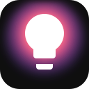

<p align="center">
  
</p>

<h1 align="center">AmbiTube</h1>

<p align="center">
  Ambient lighting for YouTube™ videos — the colors of the video softly light up the whole page.<br>
  <a href="README.fr.md">Version française</a>
</p>

---

> **Work in progress.** AmbiTube is being built step by step. See the [roadmap](#roadmap) below.

## Why AmbiTube?

Ambient light extensions already exist, and they are great, but they often expose dozens of settings.
AmbiTube aims for the **same visual quality with a much simpler experience**:

- **One button** in the player, right next to autoplay: a small light bulb.
- **Ready-made presets** (*Subtle · Balanced · Intense*) and up to 6 presets of your own.
- **Four essential sliders** (intensity, blur, spread, colors); everything else is automatic or tucked away under *Advanced*.
- An optional **immersive mode** that dims the suggested video thumbnails.
- Works in **default and theater view**, in **dark and light theme**, and on the side bars of **ultrawide screens** in fullscreen.
- Available in **English and French**.

## Install (development version)

1. Download or clone this repository.
2. Open `chrome://extensions` in Chrome.
3. Turn on **Developer mode** (top right).
4. Click **Load unpacked** and select the `extension` folder.
5. Open any YouTube video: the light bulb appears next to the autoplay toggle. Click it to open the menu.

After changing the code, click the reload icon on the AmbiTube card in `chrome://extensions`, then refresh YouTube.

## Project structure

```
extension/          ← the folder loaded by Chrome
  manifest.json
  _locales/         ← translations (en, fr)
  content/          ← scripts injected into YouTube
    core.js         ← shared namespace, translations, settings
    menu.js         ← the settings menu (presets, sliders, immersive mode)
    player-button.js← the light bulb button
    glow-renderer.js← WebGL renderer of the light
    ambient-light.js← when and where the light is shown
    main.js         ← startup and YouTube navigation handling
    content.css
  icons/
assets/             ← source artwork (icon.svg)
scripts/            ← helper scripts (icon generation)
```

## Roadmap

- [x] **Step 1 — Foundations:** Manifest V3, translations, light bulb button in the player
- [x] **Step 2 — Ambient light:** live colors spreading over the whole page (default & theater view), native YouTube ambient mode turned off automatically
- [x] **Step 3 — Menu:** presets, four main sliders, *Advanced* section, settings kept between videos, **immersive mode** (dimmed thumbnails that light up on hover)
- [ ] **Step 4 — Black bars:** detection of bars inside the video, top/bottom bars for 21:9 content, side bars on ultrawide screens in fullscreen
- [ ] **Step 5 — Polish & release:** light theme with a first-run tip, performance, privacy policy, Chrome Web Store listing

## Privacy

AmbiTube runs only on `www.youtube.com`, stores its settings in your Chrome profile and sends no data anywhere.

## Credits

AmbiTube is inspired by [Ambient light for YouTube™](https://github.com/WesselKroos/youtube-ambilight) by **Wessel Kroos** (MIT License).
Icons from Google's [Material Icons](https://github.com/google/material-design-icons) (Apache License 2.0).
See [THIRD_PARTY_NOTICES.md](THIRD_PARTY_NOTICES.md).

AmbiTube is not affiliated with YouTube or Google. YouTube is a trademark of Google LLC.

## License

[MIT](LICENSE) © 2026 Amine Charit
